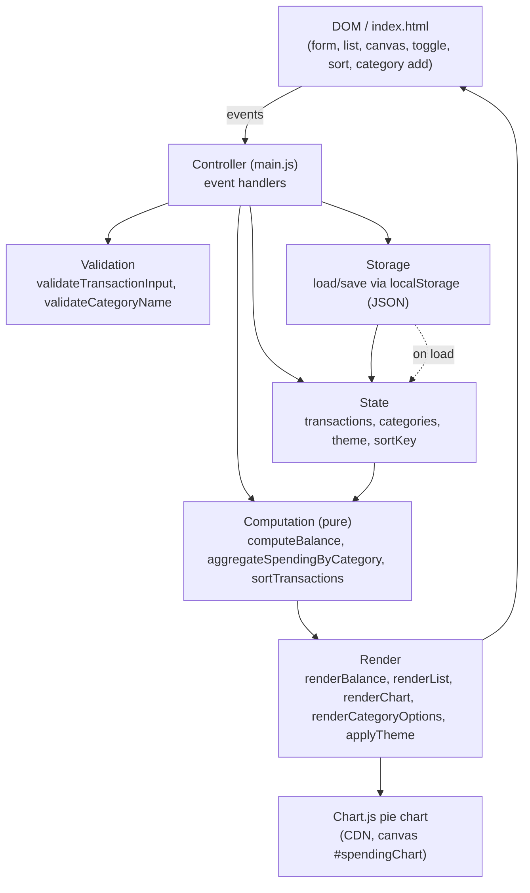
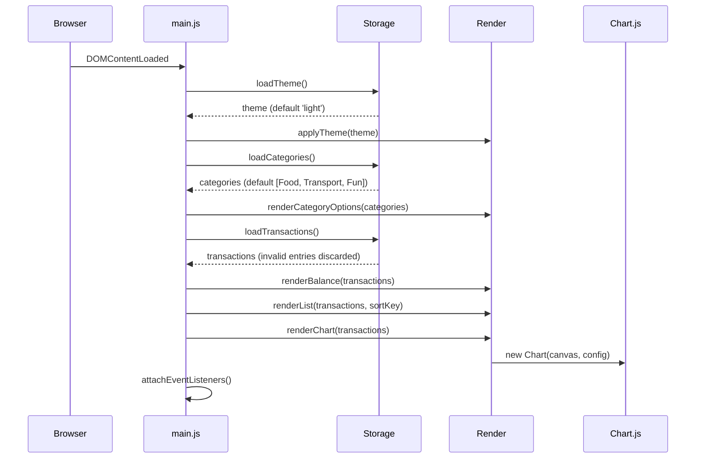

# Design Document

## Overview

The Expense & Budget Visualizer is a fully client-side web application built with Vanilla JavaScript, CSS, and a single Chart.js dependency loaded from a CDN. It lets users record income and expense transactions, see a running total balance, manage transaction entries, add custom categories, toggle between dark and light themes, sort transactions, and visualize spending distribution by category in a pie chart. All state is persisted in the browser's Local Storage, so the app works offline and without any backend server.

The application is intentionally constrained to exactly three source files:

- `index.html` — page structure, Chart.js CDN `<script>` tag, and the `js/main.js` entry point.
- `css/style.css` — all styling, theming, and responsive layout.
- `js/main.js` — all application logic (state, storage, validation, computation, rendering, and event handling).

No frameworks (React, Vue, etc.) and no build step are used. The design favors a small, well-separated set of pure functions for the logic that matters (balance computation, category aggregation, sorting, serialization) so that the core behavior is testable independently of the DOM and the browser storage API.

### Scope and Key Design Decisions

- **Income/Expense type selector.** Requirement 1.4 requires income transactions to increase the Total Balance and expense transactions to decrease it. The Input Form therefore includes a fourth control — a Type selector (`Income` / `Expense`) — in addition to Item Name, Amount, and Category. This is the only way to satisfy Req 1.4 with positive amount validation (Req 2.5 requires amounts in `0.01`–`999,999,999.99`). This was confirmed with the user.
- **Chart shows spending (expenses) only.** The Spending_Chart is described as "spending distribution by category" (Req 4.1). It aggregates **expense** transactions grouped by category. Income transactions are excluded from the chart but still affect the Total Balance. This is a deliberate interpretation of "spending"; flagged for review.
- **Balance = sum(income amounts) − sum(expense amounts).** Each transaction's `amount` is always a positive number; the `type` field determines whether it adds to or subtracts from the balance.
- **Single-file logic with clear internal separation.** Because the constraint allows only one JS file, `main.js` is organized into logical sections (State, Storage, Validation, Computation, Render, Controller) rather than separate modules. Pure logic functions are kept free of DOM and storage side effects where possible.

## Architecture

The application follows a lightweight unidirectional flow: **User action → Controller → mutate State → persist to Storage → re-render Views (Balance, List, Chart) → update Chart.js**. There is no framework; the Controller layer orchestrates state mutations and calls render functions that imperatively update the DOM.



### Layer Responsibilities

| Layer | Responsibility | Side effects |
| --- | --- | --- |
| State | In-memory source of truth (`transactions`, `categories`, `theme`, `sortKey`) | None |
| Storage | Read/write JSON to Local Storage; discard invalid data on load | localStorage I/O |
| Validation | Check form inputs and custom category names; return structured errors | None (pure) |
| Computation | Balance, chart aggregation, stable sorting | None (pure) |
| Render | Imperatively update DOM nodes and Chart.js instance | DOM + Chart.js |
| Controller | Wire DOM events to state mutations, validation, storage, and renders | Orchestrates |

### File Layout

```
/
├── index.html          # Structure + Chart.js CDN + main.js entry
├── css/
│   └── style.css       # Theme variables, layout, components, responsive
└── js/
    └── main.js         # All logic (organized into sections)
```

### Initialization Flow



## Components and Interfaces

All functions live in `js/main.js`. The signatures below define the contracts between the internal layers. Functions marked *(pure)* have no DOM or storage side effects and are the primary targets for property-based testing.

### State

```js
// Central mutable state object.
let state = {
  transactions: [],        // Transaction[]
  categories: [],         // string[] (includes defaults + custom)
  theme: 'light',         // 'light' | 'dark'
  sortKey: 'amount',      // 'amount' | 'category'
};
```

### Storage

```js
// Reads transactions from Local Storage; discards entries that fail validation
// and returns only valid ones (Req 5.7). Never throws to the caller.
function loadTransactions() /* -> Transaction[] */

// Serializes and saves all transactions. Returns true on success, false on
// failure (e.g., QuotaExceededError). Caller shows an error on false (Req 5.5).
function saveTransactions(transactions) /* -> boolean */

// Removes a single transaction by id from persistence. Returns success boolean
// (Req 3.6 / 5.2).
function deleteTransactionById(id) /* -> boolean */

function loadCategories() /* -> string[] */              // default + custom (Req 7.4)
function saveCategories(categories) /* -> boolean */    // (Req 7.3)
function loadTheme() /* -> 'light' | 'dark' */          // default 'light' (Req 6.5)
function saveTheme(theme) /* -> boolean */               // (Req 6.3)
```

### Validation

```js
// Returns { valid: boolean, errors: { field: message } }.
// Checks: name non-empty after trim, amount numeric in [0.01, 999999999.99],
// category selected, type is 'income'|'expense'. (Req 2.3, 2.5)
function validateTransactionInput(input) /* -> { valid, errors } */   // (pure)

// Validates a numeric string for the amount range. (Req 2.5)
function validateAmount(value) /* -> { valid, message } */            // (pure)

// Validates a custom category name: length 1–30, non-empty, not a duplicate
// of an existing category (case-sensitive). (Req 7.1, 7.5)
function validateCategoryName(name, existingCategories) /* -> { valid, message } */  // (pure)
```

### Computation

```js
// Total Balance = sum(amount where type==='income') - sum(amount where type==='expense').
// (Req 1.4)
function computeBalance(transactions) /* -> number */               // (pure)

// Groups EXPENSE transactions by category, sums amounts, and returns
// { labels: string[], data: number[] } excluding categories whose total <= 0.
// Order is stable (insertion order of first appearance). (Req 4.1)
function aggregateSpendingByCategory(transactions) /* -> { labels, data } */  // (pure)

// Returns a new array sorted by sortKey: 'amount' ascending numeric, or
// 'category' ascending alphabetical (case-insensitive localeCompare). Stable:
// equal-key transactions keep their relative input order. (Req 8.2–8.4)
function sortTransactions(transactions, sortKey) /* -> Transaction[] */  // (pure)

// Serializes transactions to a JSON string and parses it back; used to verify
// round-trip integrity. (Supports Req 5.1/5.3)
function serializeTransactions(transactions) /* -> string */         // (pure)
function deserializeTransactions(json) /* -> { valid: Transaction[], invalid: number } */  // (pure)
```

### Render

```js
function renderBalance(transactions)            // updates #totalBalance text
function renderList(transactions, sortKey)      // rebuilds #transactionList; empty-state message (Req 3.5)
function renderChart(transactions)              // updates/creates Chart.js pie; empty-state (Req 4.3)
function renderCategoryOptions(categories)     // rebuilds <select> options (Req 2.2, 7.2)
function applyTheme(theme)                      // toggles data-theme + toggle label (Req 6.2)
function showError(message, field?)             // displays inline/area error messages
function clearErrors()                          // removes displayed error messages
```

### Controller (event handlers)

```js
function handleAddTransaction(event)   // validate -> create Transaction -> save -> re-render (Req 2, 1.2, 5.1)
function handleDeleteTransaction(id)   // deleteTransactionById -> on fail keep row + error (Req 3.6, 5.5)
function handleThemeToggle()           // flip theme -> save -> applyTheme (Req 6.2, 6.3)
function handleSortChange(sortKey)     // set state.sortKey -> renderList (Req 8.1–8.4)
function handleAddCategory()            // validate name -> save -> renderCategoryOptions (Req 7)
function handleDOMContentLoaded()       // initialization flow (above)
```

### DOM Contract (index.html)

`index.html` must provide these element IDs/classes that `main.js` depends on:

| Element | Selector | Purpose |
| --- | --- | --- |
| Total balance | `#totalBalance` | Large blue balance text (Req 1.1) |
| Name input | `#itemName` | Transaction name field |
| Amount input | `#itemAmount` | Transaction amount field |
| Category select | `#itemCategory` | Category dropdown (Req 2.2) |
| Type select | `#itemType` | Income/Expense selector (Req 1.4) |
| Add button | `#addTransactionBtn` | Submit transaction (Req 2.4) |
| Custom category input | `#customCategoryName` | New category name (Req 7.1) |
| Add category button | `#addCategoryBtn` | Persist custom category (Req 7) |
| Sort control | `#sortControl` | Sort by amount/category (Req 8.1) |
| Transaction list | `#transactionList` | Scrollable list container (Req 3.1) |
| Chart canvas | `#spendingChart` | Chart.js pie target (Req 4.1) |
| Theme toggle | `#themeToggle` | Dark/light switch (Req 6.1) |
| Error area | `#errorArea` | Aggregate error messages |

## Data Models

### Transaction

A single spending or income record. The `id` uniquely identifies a transaction for deletion and persistence.

```js
// Transaction
{
  id: string,         // unique id, generated via crypto.randomUUID() (fallback: Date.now()+random)
  name: string,       // item name, non-empty after trim
  amount: number,      // positive number in [0.01, 999999999.99], 2 decimal places
  category: string,   // category name (a default or a custom category)
  type: string        // 'income' | 'expense'
}
```

Validation invariants for a *valid* Transaction:
- `name` is a string with length ≥ 1 after trimming whitespace.
- `amount` is a finite number, `0.01 <= amount <= 999999999.99`.
- `category` is a non-empty string present in the current category set.
- `type` is exactly `'income'` or `'expense'`.
- `id` is a non-empty string unique within the transaction collection.

### Application State

```js
// AppState (in-memory)
{
  transactions: Transaction[],
  categories: string[],     // e.g. ['Food', 'Transport', 'Fun', ...custom]
  theme: 'light' | 'dark',
  sortKey: 'amount' | 'category'
}
```

### Local Storage Schema

All values are stored as JSON strings under fixed keys on the client device (Req 5.4). No backend is used.

| Key | Type | Default | Requirement |
| --- | --- | --- | --- |
| `ebv_transactions` | JSON `Transaction[]` | `[]` | Req 5.1, 5.2, 5.3 |
| `ebv_categories` | JSON `string[]` | `["Food","Transport","Fun"]` | Req 7.3, 7.4 |
| `ebv_theme` | JSON `"light"\|"dark"` | `"light"` | Req 6.3, 6.4, 6.5 |

### Derived/View Models

- **Balance view model:** `number` rendered as currency-formatted text in `#totalBalance`.
- **Chart view model:** `{ labels: string[], data: number[] }` from `aggregateSpendingByCategory`; passed to Chart.js as `data.labels` and `data.datasets[0].data`. A palette array of background colors is mapped positionally to segments.
- **List view model:** `Transaction[]` after `sortTransactions`, each rendered as a row with name, amount, category, type, and a Delete button.

### Serialization Format

Transactions are stored as a JSON array of objects in the exact shape above. On load, `deserializeTransactions` parses the JSON and runs each entry through validation; entries that fail are counted as invalid and discarded (Req 5.7), while valid entries are kept. This keeps a single canonical serialization round-trip for the whole collection.

## Correctness Properties

*A property is a characteristic or behavior that should hold true across all valid executions of a system — essentially, a formal statement about what the system should do. Properties serve as the bridge between human-readable specifications and machine-verifiable correctness guarantees.*

The property-based tests below target the pure logic layer of this application (balance computation, category aggregation, sorting, serialization, validation, theme handling) and storage-backed behavior exercised with mocked storage. UI rendering, responsive layout, performance, browser compatibility, and direct storage-wiring are covered by example, integration, and smoke tests described in the Testing Strategy — they either do not vary meaningfully with input or are visual/infrastructure concerns not suited to universal properties.

### Property 1: Balance computation

*For any* valid transaction list, `computeBalance(transactions)` equals the sum of `amount` over transactions where `type === 'income'` minus the sum of `amount` over transactions where `type === 'expense'`. An empty list yields `0`.

**Validates: Requirements 1.4** (supports 1.2, 1.3)

### Property 2: Spending aggregation correctness and zero-total exclusion

*For any* transaction list, `aggregateSpendingByCategory(transactions)` returns `labels`/`data` such that (a) every returned label is an expense category whose total expense amount is greater than zero, (b) each returned `data` value equals the sum of `amount` over expense transactions in that category, and (c) every expense category with a total greater than zero is included exactly once.

**Validates: Requirements 4.1** (supports 4.2)

### Property 3: Stable ascending sort by key

*For any* transaction list and `sortKey` in `{'amount','category'}`, `sortTransactions(transactions, sortKey)` returns a sequence that is non-decreasing by `sortKey` (numeric for `amount`, alphabetical for `category`) and in which transactions sharing an equal key value preserve their original relative input order.

**Validates: Requirements 8.2, 8.3, 8.4**

### Property 4: Transaction serialization round-trip

*For any* valid transaction set, serializing it with `serializeTransactions` and then deserializing the result with `deserializeTransactions` yields an equivalent set of transactions (same ids, names, amounts, categories, and types).

**Validates: Requirements 5.3**

### Property 5: Invalid storage data is discarded

*For any* JSON payload containing a mix of valid and invalid transaction entries (wrong types, missing fields, out-of-range amounts, etc.), `deserializeTransactions` returns exactly the valid entries and discards every invalid entry, never throwing.

**Validates: Requirements 5.7**

### Property 6: Invalid transaction input is rejected

*For any* transaction input where at least one required field is empty after trimming, or the amount is non-numeric or outside the range `[0.01, 999999999.99]`, `validateTransactionInput` returns `valid === false` and its `errors` object reports the offending field(s).

**Validates: Requirements 2.3, 2.5**

### Property 7: Valid transaction input maps to a matching transaction

*For any* transaction input with all fields valid, the transaction produced from the input has `name` (trimmed), `amount`, `category`, and `type` equal to the input values and is assigned a unique, non-empty `id`.

**Validates: Requirements 2.4**

### Property 8: Delete removes exactly the targeted transaction

*For any* transaction set and any member of it, removing that member by `id` removes exactly that one transaction and leaves every other transaction in its original relative order.

**Validates: Requirements 3.4** (in-memory portion)

### Property 9: Storage failure retains the transaction and shows an error

*For any* transaction and any storage operation (save on create or remove on delete) that fails (mocked), the transaction is retained in the in-memory session state and an error message is displayed to the user.

**Validates: Requirements 3.6, 5.5**

### Property 10: Theme toggle is an involution

*For any* current theme, toggling produces the other theme, and toggling twice returns to the original theme (`toggle(toggle(t)) === t`).

**Validates: Requirements 6.2** (supports 6.1)

### Property 11: Theme persistence round-trip

*For any* theme value, saving it to storage and then loading it yields the same theme value.

**Validates: Requirements 6.3, 6.4**

### Property 12: Custom category validation

*For any* category name and existing category set, `validateCategoryName` returns `valid === true` if and only if the trimmed name has length in `[1, 30]` and is not a duplicate of an existing category; otherwise it returns `valid === false` and the rejected name is not persisted.

**Validates: Requirements 7.1, 7.5**

### Property 13: Custom category persistence round-trip

*For any* category set (defaults plus custom categories), saving it to storage and then loading it yields the same category set.

**Validates: Requirements 7.4**

## Error Handling

The application treats the browser Local Storage API and Chart.js as untrusted external surfaces and degrades gracefully when they fail.

### Storage Errors

- **Save failure (Req 5.5):** `saveTransactions` and `saveCategories`/`saveTheme` wrap `localStorage.setItem` in `try/catch`. `QuotaExceededError` and `SecurityError` (e.g., sandboxed iframe or blocked storage) cause the function to return `false`. The Controller, on `false`, retains the transaction in the in-memory session state, calls `showError('Failed to save the transaction. It is kept for this session.')`, and still re-renders the in-memory views so the user does not lose the entry visually.
- **Delete failure (Req 3.6):** `deleteTransactionById` wraps the persistence removal in `try/catch`. On failure it returns `false`; the Controller keeps the row in the `Transaction_List` and calls `showError('Failed to delete the transaction. It has been kept.')`.
- **Unavailable storage:** On load, if `localStorage` access throws (private mode / disabled), the app catches the error, treats storage as empty, and proceeds with defaults (zero balance, empty list, light theme, default categories) so the app still renders.

### Corrupt / Invalid Data (Req 5.7)

- `loadTransactions` reads the raw string, `JSON.parse`s it (catching `SyntaxError`), and runs every parsed entry through `validateTransactionInput`/a transaction validator. Entries that fail are counted and discarded; only valid entries populate `state.transactions`. If the whole payload is unparseable, it is treated as empty.
- `loadCategories` and `loadTheme` apply the same parse-then-validate discipline; a bad theme value falls back to `'light'` (Req 6.5), and bad category entries are dropped.

### Input Validation Errors (Req 2.3, 2.5, 7.5)

- Empty/whitespace fields: `validateTransactionInput` reports each empty field by key so the UI can highlight exactly those inputs.
- Out-of-range / non-numeric amount: a single range message is attached to the amount field.
- Invalid custom category (empty, >30 chars, or duplicate): rejected before persistence, with an error message naming the cause; the existing category set is unchanged.

### Chart.js Errors

- If the Chart.js CDN fails to load, `renderChart` guards on `typeof Chart === 'undefined'` and shows the empty-chart message instead of throwing.
- Chart updates reuse the existing `Chart` instance where possible (mutate `chart.data` then `chart.update()`); if the instance is unavailable, a new one is created. The canvas is given a fixed-height container so Chart.js responsiveness does not cause layout overflow.

### Rendering Resilience

- All render functions bail out safely on missing DOM nodes (defensive `querySelector` checks) so a markup mismatch never throws at runtime; combined with the error-area pattern, the user always sees either correct data or a clear message.

## Testing Strategy

A dual approach is used: property-based tests for universal logic, and example/integration/smoke tests for UI, rendering, performance, and cross-browser behavior.

### Test Framework and PBT Library

- **Runner:** Vitest (fast, ESM-friendly, works with `jsdom` for DOM tests) — invoked with `--run` for single execution (no watch mode in CI).
- **Property-based testing library:** `fast-check` (the standard PBT library for JavaScript/TypeScript).
- **DOM environment:** `jsdom` for tests that touch the DOM (render functions, list/chart empty states).
- **Storage mocking:** a `localStorage` mock (or Vitest's `jsdom` built-in storage) that can be programmed to throw `QuotaExceededError`/`SecurityError` to exercise failure paths.

### Property-Based Tests (PBT)

Each correctness property below is implemented as a single `fast-check` property test configured to run a **minimum of 100 iterations**, and tagged with a comment referencing the design property:

`/** Feature: expense-budget-visualizer, Property {n}: {property_text} */`

| # | Property | Target function | Generator notes |
| --- | --- | --- | --- |
| 1 | Balance computation | `computeBalance` | random transaction lists with mixed income/expense, amounts, decimals |
| 2 | Aggregation correctness + zero-total exclusion | `aggregateSpendingByCategory` | random lists with multiple categories, expense/income mix, zero-total categories |
| 3 | Stable ascending sort by key | `sortTransactions` | random lists with duplicate amounts/categories to exercise stability |
| 4 | Transaction serialization round-trip | `serializeTransactions`/`deserializeTransactions` | random valid transaction sets incl. unicode names, decimal amounts |
| 5 | Invalid storage data discarded | `deserializeTransactions` | random payloads mixing valid and invalid entries |
| 6 | Invalid transaction input rejected | `validateTransactionInput` | random inputs with arbitrary empty-field subsets and bad amounts (incl. boundaries 0, 0.009, 999999999.99, 1000000000) |
| 7 | Valid input → matching transaction | transaction factory | random valid inputs |
| 8 | Delete removes exactly the targeted transaction | remove-by-id helper | random sets + random member to remove |
| 9 | Storage failure retains transaction + shows error | Controller save/delete (mocked storage) | random transactions; mock storage to throw |
| 10 | Theme toggle involution | toggle helper | both starting themes |
| 11 | Theme persistence round-trip | `saveTheme`/`loadTheme` (mocked) | both theme values |
| 12 | Custom category validation | `validateCategoryName` | random names across lengths 0–35 and duplicate scenarios (boundaries 1, 30, 31) |
| 13 | Custom category persistence round-trip | `saveCategories`/`loadCategories` (mocked) | random category sets incl. unicode |

### Example-Based Unit Tests

- **Input form structure (Req 2.1, 2.2):** assert the form contains name/amount/category/type inputs and the add button, and the category select initially lists Food, Transport, Fun.
- **Transaction list rendering (Req 3.1, 3.3):** render representative transaction sets with `jsdom`; assert every transaction's name, amount, and category appears and each row has exactly one Delete button.
- **Empty states (Req 3.5, 4.3, 5.6):** rendering with no transactions shows the no-transactions message, the no-spending-data chart message, and a zero balance.
- **Theme default (Req 6.5):** loading with no saved theme applies `light`.
- **Sort control (Req 8.1):** the sort control offers amount and category options.
- **Storage wiring (Req 5.1, 5.2, 6.3, 7.3):** example tests asserting create persists, delete removes, theme change persists, and added category persists (mocked or real storage).
- **Validation messages (Req 2.3, 2.5, 7.5):** example tests asserting the correct field is indicated for each rejection case.

### Integration / Smoke Tests

- **Initialization smoke (Req 5.4, 5.6, 10.3, 12.3):** the app loads from empty storage with no setup, no network calls, and renders the empty initial state within 500 ms.
- **End-to-end add/view/delete flow (Req 3.4, 4.2):** add a transaction, confirm balance/list/chart update, delete it, confirm they update again.
- **Performance (Req 10.1, 10.2):** integration tests measuring that view updates after add/delete complete within 100 ms and load within 500 ms for representative data.
- **Responsive layout (Req 9.1, 9.2, 9.3):** example tests at viewport widths ≥ 768 px (side-by-side) and < 768 px (stacked), plus section ordering.
- **Cross-browser (Req 11.1, 11.2):** manual or CI matrix smoke across the two most recent stable major versions of Chrome, Firefox, Edge, and Safari; assert no console errors and add/view/delete works.
- **Visual/Accessibility (Req 12.1, 12.2, 12.4):** assert ≤ 5 interactive controls on initial load, body font-size ≥ 14 px, computed contrast ratios ≥ 4.5:1 for text/background pairs, and primary headings larger than secondary labels.

### Test Coverage Mapping Summary

- **Property tests** validate the pure logic and storage-backed universal behavior (Properties 1–13).
- **Example unit tests** validate specific UI structure, empty states, validation messages, and storage wiring.
- **Integration/smoke tests** validate initialization, end-to-end flows, performance, responsive layout, cross-browser, and visual accessibility.
- Requirements not expressed as properties (UI rendering, layout, performance, browser compatibility, no-setup) are explicitly covered by the example/integration/smoke categories above so every acceptance criterion has a test home.

